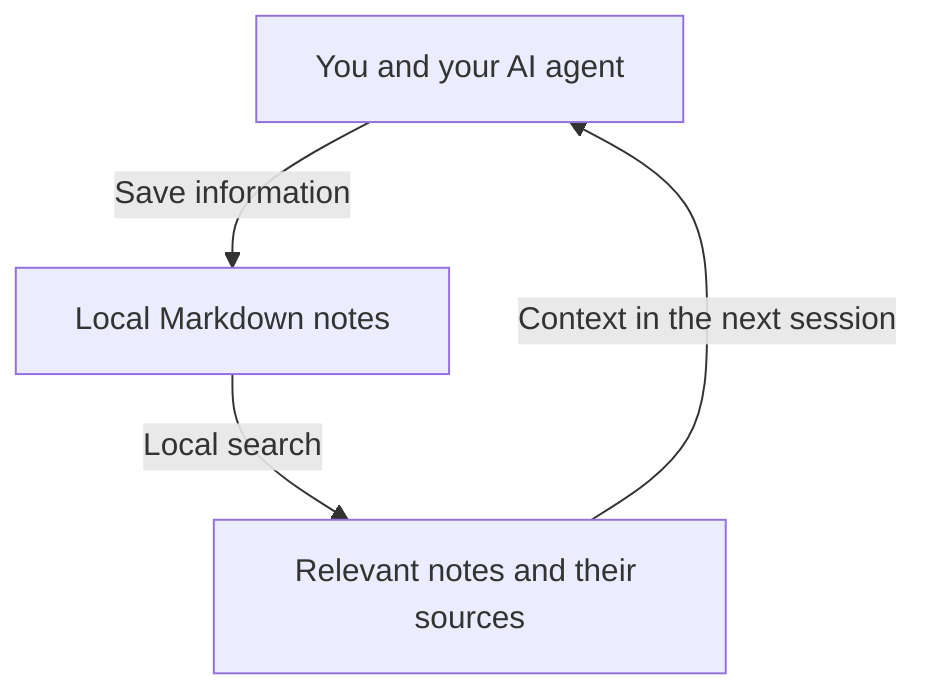

# Second Brain

> **English edition.** This repository is an English translation of [avenoxai/avenoxbeyin](https://github.com/avenoxai/avenoxbeyin) (MIT), which is written in Turkish. All credit for the system goes to the original author. Command, file and folder names keep their original Turkish spelling (`beyin` = brain, `yakala` = capture, `doktor` = doctor, `guncelle` = update, `kur` = install, `durum` = status) so that vaults stay compatible with upstream.


**Even if you switch AI clients, your notes, decisions and tasks stay in the same place.**

AvenoxBeyin is a local memory system you can use with your AI agents. It has your agent save important information to Markdown files, and in the next session you find it again, with its source. You can open the folder in Obsidian or in any text editor you like.

**[Jump to setup](#kurulum)** · [Download the latest release](https://github.com/uy4nik-droid/avenoxbeyin-english/releases/latest) · [Visual setup guide](https://avenox.io/ikincibeyin) · [Docs](#belgeler)

macOS · Windows · Linux &nbsp; | &nbsp; Python 3.11+ &nbsp; | &nbsp; [MIT license](LICENSE)

## What is it for?

| What you want | What you can do with Beyin |
| --- | --- |
| Pick up where you left off in a new session | Save the result of your last task, open issues and the next step as source notes |
| Find a decision you made earlier | Search your notes and open the file where the decision appears |
| Not lose a source | Put a video, article or file into your inbox with **Yakala** (capture) |
| Move from Claude to Codex | Use the same folder of notes and tasks with another supported client |

Keep a separate copy of the vault: [Backup without knowing Git, or with a private Git repository](docs/v3/BACKUP.md).

### How does it work?



Your files are the source of truth. Beyin keeps a local index of them and hands the selected context to the AI client you use. It does not turn your whole chat history into knowledge on its own; you have the agent write down whatever you want to keep.

> **New in V3.13.0:** Optional send from Yakala to Claude/Codex, reading Word (.docx) documents, a Pi connection and an OpenCode global bridge. The local web view and workspace tools are also in this release. [All changes](docs/v3/releases/3.13.0.md).

<a id="kurulum"></a>
## Setup in three steps

**You need:** Python **3.11+** and a supported AI client. The client's own installation and account are separate requirements. Beyin's basic setup does not need Git, pip, a Mem0 account, an extra API key or an always-on server. Obsidian is optional.

### 1. Pick a folder

It can be a new folder or your existing Obsidian vault. You don't need to move your notes anywhere else.

### 2. Open that folder in your AI client

Use Claude Code, Codex or one of the [clients](#istemciler) below. Make sure the setup runs in the folder you want.

### 3. Paste this message

```text
Read https://raw.githubusercontent.com/uy4nik-droid/avenoxbeyin-english/main/beyin.md. Set up my second brain in this folder.
If there is an existing installation, update it and keep my notes. Do the
necessary downloads and setup steps yourself. At the end, let's verify it
together by saving a sample piece of information and reading it back in a
new session.
```

The agent downloads the official stable package, verifies the checksum and checks the installation. Complete the folder or hook trust review that your client shows. Then **open a new session in the same folder**; in Codex, review the new hook definitions on the `/hooks` screen.

<details>
<summary><strong>I want to install it myself from the terminal</strong></summary>

1. From the [latest release](https://github.com/uy4nik-droid/avenoxbeyin-english/releases/latest), download **`beyin-v3-X.Y.Z.zip`** and the **`.sha256`** file next to it. Don't pick GitHub's **Source code** archive.
2. Compare the ZIP's SHA-256 value with the file next to it, then unpack the package. [Verification steps](beyin.md).
3. Open a terminal **in the folder you unpacked**. Replace the vault path with your own notes folder:

**macOS / Linux**

```sh
python3 scripts/install_v3.py --vault "/full/path/MyBrain"
```

**Windows**

```powershell
py -3 scripts/install_v3.py --vault "C:\Notes\MyBrain"
```

The installer puts the engine, the client connections and the four starter skills into the vault. You don't need to keep the package folder open. Open the vault in your client, complete the trust review and start a new session. [Detailed setup](SETUP-V3.md).

</details>

## The first 5 minutes

Tell your agent the following, in order. These are example messages; replace them with your own details.

| Step | Tell your agent |
| --- | --- |
| **Get acquainted** | "Use the beyin skill. Ask me a few short questions to get to know me and save my answers to my notes." |
| **Save** | "For the sample project I chose Python, because the team knows Python. Save this as a decision note." |
| **Find it again** | Open a new session: "Which language did we pick for the sample project, and why? Show the source note." |
| **Create a task** | "Create a task for me to prepare the first draft of the sample project." |

Check the saving in the file and the recall in the new session. That way you also see that the connection works in your own client.

<details>
<summary><strong>What do the four installed skills do?</strong></summary>

| Skill | Use |
| --- | --- |
| **beyin** | Finding notes, saving information, creating tasks and work results |
| **beyin-doktor** | Checking connection, saving and setup problems |
| **beyin-guncelle** | Updating, version checks and rollback |
| **beyin-kontrol** | Checking whether information in memory is still correct; runs only when you ask, and does not write without your approval |

The shared source lives in `.agents/skills`; Claude and Kiro use their own project copies. Your existing personal skills are not silently overwritten.

</details>

<a id="istemciler"></a>
## Which clients does it work with?

| Client | After setup |
| --- | --- |
| **Claude Code** | Open a new session in the vault folder. |
| **Codex** | Review the new hook definitions with `/hooks`; open a new session. |
| **Google Antigravity** | Open the vault as a workspace and trust the folder. [Setup](SETUP-V3.md) |
| **Kiro** | Review the hooks; open a new session. [Guide](docs/v3/KIRO.md) |
| **Hermes Agent** | Set up the profile connection and enable the `beyin-v3` plugin. [Guide](docs/v3/HERMES.md) |
| **OpenCode** | Open it in the vault folder; the plugin loads. [Guide](docs/v3/OPENCODE.md) |
| **OMP / Oh My Pi** | Open it in the vault folder; the hook loads. [Guide](docs/v3/OMP.md) |
| **Pi** | Approve project trust for the extension; open a new session. [Guide](docs/v3/PI.md) |
| **DeepSeek Harness (DSH)** | Explicit `context`/`receipt` CLI use only; automatic delivery is not verified. [Guide](docs/v3/DSH.md) |

Clients differ in their hook and trust flows. In Codex Desktop, explicit skill use is not the same thing as automatic hook delivery; the automatic Desktop flow is not yet considered verified. [Real-client checks](docs/v3/LIVE-CLIENTS.md).

To reach your central brain while working in other project folders, there is an [optional global bridge](docs/v3/GLOBAL-BRIDGE.md).

## Capture a source with one keystroke

Put a video, tweet, article, email or file into your inbox. Then tell your agent **"process the captures"** and it extracts the text and links it into your notes.

**Once, in the vault folder:**

```sh
python3 beyin.py yakala kur
```

| macOS | Windows | Linux |
| --- | --- | --- |
| `Control + Option + B` | `Ctrl + Alt + B` | `Ctrl + Alt + B` on KDE Plasma; for other desktops see the [guide](docs/v3/YAKALA.md) |

By default, **Enter** only saves the card. If you like, you can separately enable the Claude Code or Codex agent mode and send that card to the agent with **Ctrl+Enter**. Word (.docx) documents are supported; extra jobs such as transcribing YouTube audio may need separate tools. [Yakala guide](docs/v3/YAKALA.md).

## Look at your brain in the browser

See your tasks, recent work results and the doctor summary on one screen. Open the optional web view **in the vault folder**:

```sh
python3 beyin.py web ac
```


*The real interface, shown with sample notes and tasks, in read-only mode. It contains no personal data.*

It opens only on this computer and closes after 30 minutes of inactivity. It does not start on its own during setup. To only view, use `web ac --read-only`. [Web guide](docs/v3/WEB.md).

## Updates and help

To update, tell your agent **"update my brain"**; if something is wrong, say **"check with beyin-doktor"**. If you prefer the terminal, run these **in the vault folder**:

```sh
python3 beyin.py update --check   # Check for a new version
python3 beyin.py update          # Update
python3 beyin.py doctor          # Check the installation and connections
```

**Windows:** In the `python3 beyin.py ...` commands on this page, use `py -3` instead of `python3`.

**If you use Yakala**, run `python3 beyin.py yakala kur` once more after an update, so the separately copied listener and skill are refreshed too. Open a new session in your client. If you use the global bridge, also check the release's [reinstall notes](docs/v3/releases/3.13.0.md).

Your user notes are separate from the system files that get updated. If you have your own changes in a managed file, it is not silently overwritten; the conflict is reported. [Offline update, `rollback` and `recover`](docs/v3/UPDATE.md).

## Frequently asked

<details>
<summary><strong>Where are my notes? What goes to the AI provider?</strong></summary>

Your notes live in local Markdown files, and the index is kept on this computer. The selected context is given to your AI client; the client's model provider and account terms apply. "Local memory" does not mean the whole AI conversation is offline.

Private-note markers affect Beyin's context and web filters; they do not create operating-system-level protection against an agent you have given file access. [Source format and visibility](docs/v3/MARKDOWN.md).

</details>

<details>
<summary><strong>Is there an extra cost or an always-running service?</strong></summary>

The basic local checks do not call a model. The work you have the agent do and the context that gets added fall under your client's normal consumption. You can say "switch to economy mode" or "turn off automatic checks"; supported clients use the same vault preference.

There is no service that continuously scans memory while the clients are closed. The Yakala listener and the web view are separate, optional tools. The version notice checks GitHub at most once a day; it does not send notes and does not install updates on its own. The optional Jev advisor is off by default.

[Normal / Economy / Manual modes](docs/v3/PREFERENCES.md) · [Jev](docs/v3/JEV.md)

</details>

<details>
<summary><strong>Does it remember everything? What happens to my old chats?</strong></summary>

Search relies on local word matching; there is no guarantee of correct recall on every question. Have important decisions written to a note and have the source opened when needed. A work-result record is also a claim written by the agent; it is no substitute for independent verification.

Your whole old chat history is not imported automatically. For the optional chat trace and for extracting summaries from history, see the [chat-trace guide](docs/v3/CHAT-TRACE.md); for a summary of recent work, see the [command guide](docs/v3/QUICKSTART.md).

</details>

<details>
<summary><strong>I'm coming from V2, or I'm moving the vault to another computer</strong></summary>

When moving up from V2, you run the same installer on the existing vault. Notes and old logs are kept; recognized old automatic writers are disabled in a reversible way. If there are customized files, the installer stops and explains. V2's compiler, which called a model in the background, does not run in V3.

Moving the vault and using it on several machines need separate steps; don't share the working database like an ordinary synced file.

[V2 migration](docs/v3/MIGRATION.md) · [Multiple machines](docs/v3/MULTI-MACHINE.md) · [Historical V2 guide](docs/V2-README.md)

</details>

<a id="belgeler"></a>
## Docs and contributing

| What you're looking for | Guide |
| --- | --- |
| Commands, tasks and a summary of recent work | [Command guide](docs/v3/QUICKSTART.md) |
| Startup memory, personality and archiving | [Companion](docs/v3/COMPANION-PARITY.md) |
| Workspaces and note links | [What's new in V3.13.0](docs/v3/releases/3.13.0.md) |
| Technical architecture and source format | [V3 docs](docs/v3/README.md) · [Runtime](docs/v3/RUNTIME.md) · [Markdown](docs/v3/MARKDOWN.md) |
| What has been tested? | [Platform tests](docs/v3/PLATFORM-TESTS.md) · [Real clients](docs/v3/LIVE-CLIENTS.md) |
| A bug or a contribution | [Open an issue](https://github.com/avenoxai/avenoxbeyin/issues) · [Contributing guide](CONTRIBUTING.md) |

Developed out of Avenox's day-to-day second-brain workflows. Thanks to everyone who contributed. For the V2 knowledge-compilation idea, [Karpathy's knowledge-base pattern](https://gist.github.com/karpathy/442a6bf555914893e9891c11519de94f) was drawn on.
